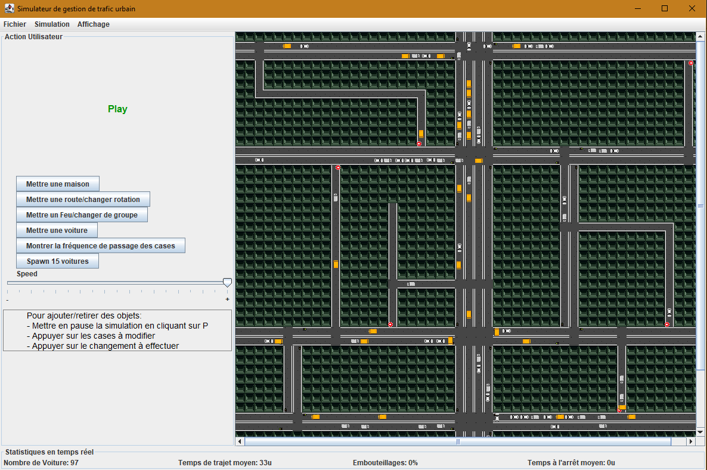

# 🚦 Simulateur de Gestion de Trafic Urbain

Projet de L2 Programmation 2024–2025 — Université

## 📌 Description

Ce projet a pour but de simuler le trafic urbain d'une ville fictive à l'aide d'une **application Java interactive**. Il comprend la modélisation d'intersections, routes, feux de signalisation, et véhicules se déplaçant selon des règles réalistes. Le simulateur permet à l'utilisateur d'interagir avec la carte, d'observer le trafic, de consulter des statistiques, et d'optimiser la circulation grâce à des algorithmes intelligents.

## 🚀 Lancement du projet

1. Cloner le projet :
   ```bash
   git clone <url_du_dépôt>
   ```

2. Compiler le projet :
   ```bash
   javac -d bin -cp src src\Controle\*.java src\Controle\SetObj\*.java src\Modele\*.java src\Modele\Enregistrer\*.java src\Modele\Signalling\*.java src\Modele\Vehicle\*.java src\Vue\*.java
   ```

3. Lancer l'application :

   Sous Windows : 
    ```bash
    java -cp "bin;." Controle.Controle
    ```
   Sous Linux : 
    ```bash
    java -cp "bin:." Controle.Controle
    ```


## 🧭 Mode d’emploi de l'application

Cette section explique comment interagir avec la simulation de trafic urbain via l’interface utilisateur. Toutes les **modifications** nécessitent que la simulation soit **mise en pause**.

### 🖼️ Aperçu de l’application




### ⏸️ Pause & Lecture de la simulation

* **Mettre en pause** : touche `P` ou menu `Simulation > Arrêter`
* **Reprendre la simulation** : touche `P` ou menu `Simulation > Reprendre`
* ⚠️ *Toute modification de la carte nécessite que la simulation soit en pause.*


### 🏠 Ajouter une maison

1. Mettre la simulation en pause.
2. Cliquer sur une case vide de la carte.
3. Cliquer sur le bouton `Ajouter une maison`.


### 🛣️ Ajouter une route

1. Mettre la simulation en pause.
2. Cliquer sur la case que vous souhaitez modifier.
3. Cliquer sur le bouton `Ajouter une route`.
4. Sélectionner la **direction souhaitée** (haut, bas, gauche, droite).
5. Pour ajouter plusieurs directions à une même case, répétez les étapes 3–4 avec d’autres directions.


### 🚦 Ajouter un feu de signalisation

> 📝 *Fonctionnalité à vérifier auprès de Augustin pour plus de détails.*


### 🚗 Ajouter une voiture

Deux options sont disponibles :

* **Destination aléatoire** :

  1. Cliquer sur une **seule case**.
  2. Cliquer sur `Ajouter une voiture`.
  3. Une voiture apparaît sur cette case, avec une destination choisie aléatoirement.

* **Trajet défini** :

  1. Cliquer sur **deux cases** : la première pour le départ, la seconde pour l’arrivée.
  2. Cliquer sur `Ajouter une voiture`.
  3. Une voiture apparaît sur la première case et se dirigera vers la seconde.

> Si l’on clique sur une voiture pendant la simulation, **son chemin actuel s’affiche**.
> Celui-ci peut **évoluer dynamiquement** en fonction du trafic.


### 🚚 Ajouter plusieurs voitures

* Le bouton `Ajouter 15 voitures` tente d’ajouter 15 véhicules.
* Les voitures apparaissent **uniquement si des emplacements d’entrée** sont disponibles (bords de la carte).


### 📈 Fréquence d’utilisation des cases

* Le bouton `Montrer la fréquence des cases` affiche, pour chaque case, **combien de fois elle a été empruntée récemment**.
* Utile pour visualiser les **zones les plus fréquentées**.


### 💾 Sauvegarde et chargement

Dans le menu `Fichier` :

* `Sauvegarder la simulation` : enregistre tout l’état de la simulation dans un fichier `.txt`.
* `Charger une simulation` : recharge une sauvegarde précédente.
* `Quitter` : ferme l’application.


### 🔍 Zoom et déplacement

* **Zoom avant/arrière** :

  * Avec la molette de la souris (en survolant la carte).
  * Ou via le menu `Affichage > Zoom avant / Zoom arrière`.

* **Déplacement de la carte** :

  * Via les **barres de défilement** (scrollbars).
  * Ou en **cliquer-glisser** sur la carte (drag and scroll fluide).


## 🎯 Objectifs pédagogiques

- Utilisation de l'architecture **Modèle-Vue-Contrôleur (MVC)**.
- Conception d’une **interface graphique avec Swing**.
- Implémentation de **règles de trafic réalistes**.
- Collecte et affichage de **statistiques en temps réel**.
- Introduction aux **algorithmes d’optimisation heuristiques**.
- Travail collaboratif avec **Git/GitLab**.

## 🛠️ Fonctionnalités principales

### 🗺️ Carte Interactive
- Affichage de routes, intersections, feux de signalisation.
- Zoom/dézoom possible.
- Routes de tailles variées.

### 🚗 Simulation de trafic
- Véhicules variés : voitures, bus, camions.
- Différences de vitesse et de taille.
- Gestion de la priorité et des feux aux intersections.

### 🚦 Gestion des feux de signalisation
- Ajout et contrôle manuel des cycles.
- Interaction utilisateur via clics.

### 📊 Statistiques en temps réel
- Temps moyen de trajet.
- Temps de parcours par route.
- Embouteillages.
- Estimation de la consommation de carburant.

### 📌 Calcul de trajets
- Utilisation de l’algorithme de Dijkstra pour déterminer les plus courts chemins entre intersections, selon les conditions de trafic.

### 🧠 Extensions
- Sauvegarde/chargement de la simulation.

## 🧱 Architecture du projet

```
C:.
├── .vscode                 # Configuration de l’environnement de développement
├── bin                    # Fichiers compilés
│
├── img                    # Images utilisées dans l’interface
├── Save                   # Fichiers de sauvegarde de simulation
└── src                    # Code source du projet
    ├── Controle           # Contrôleurs du projet
    │   └── SetObj
    ├── Modele             # Données et logique métier
    │   ├── Enregistrer
    │   ├── Signalling
    │   └── Vehicle
    └── Vue                # Interface graphique avec Swing
```

## 💻 Technologies utilisées

- **Java 17+**
- **Swing (javax.swing)** pour l’interface graphique
- **Git / GitLab** pour la collaboration
- **Timer** Swing pour l'animation
- **OOP et MVC** pour la structuration du code


## 👥 Équipe projet

- 👤 RAMANATHAN Jonas — 22308381
- 👤 POTIER Nathan — 22305976 
- 👤 GRÉGOIRE-MELLIER Noa — 22308594
- 👤 NGUYEN Le-Augustin — 22301887
- 🧑‍🏫 Superviseur : Costas Bouyioukos


## 📂 Licence

Projet académique — Utilisation libre à des fins pédagogiques uniquement.


